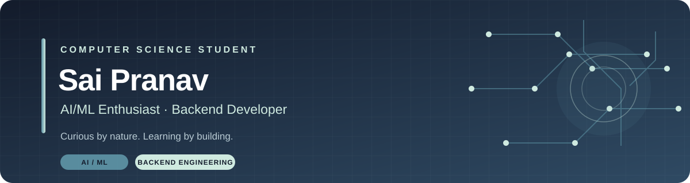

  

Personal GitHub profile showcasing my journey in AI/ML, backend engineering, problem-solving, and projects built through continuous learning and experimentation.

### AI/ML Enthusiast · Backend Developer · Problem Solver

  

<!-- 

  
  
  

 -->

---

## 👨‍💻 About Me

> **"I don't believe in knowing everything, but I believe in being willing to learn anything."**

This is the mindset I try to bring into my academic journey and personal development.

I'm a Computer Science student specializing in Artificial Intelligence and Machine Learning, interested in building intelligent applications and understanding the engineering behind reliable software systems.

- 🤖 Exploring AI/ML and experimenting with practical applications.
- ☕ Learning Java and Spring Boot to strengthen my backend engineering skills.
- ⚙️ Exploring system design, databases, Redis and backend architecture.
- 🧠 Practicing Data Structures and Algorithms to sharpen my problem-solving skills.
- 🚀 Learning through experimentation, building projects and understanding how things work under the hood.

## 🎯 What I'm Working On

**01 — Backend Engineering**

Strengthening my backend development fundamentals through Java, Spring Boot and REST APIs while exploring database management, Redis, system design and application architecture.

**02 — CareCompanion | Agentic AI Health Coach**

Developing an AI-powered health coaching application that combines activity data with conversational memory to provide personalized insights and maintain context across multiple coaching sessions.

**03 — Grantha | Heritage Tracker**

Working on a multilingual heritage-book discovery system that explores thematic relationships between historical books across eight Indian languages using OCR, multilingual representations and machine learning-based clustering.

---

## 🛠️ Tech Stack

**Programming Languages**

  

**Backend & Databases**

  

**Tools & Development**

  

**Currently Exploring**

  
  
  
  

---

## 🚀 Featured Projects

### 01. Grantha — Heritage Tracker

A multilingual heritage-book discovery system designed to uncover thematic connections between historical books without relying on predefined subject labels.

- Works with historical books across eight Indian languages.
- Explores OCR and multilingual text representations.
- Studies TF-IDF + LSA and Gemini embeddings.
- Applies PCA, hierarchical clustering and DBSCAN.
- Contributed to the clustering study and evaluation.

**Tech:** Python · NLP · Gemini Embeddings · Tesseract OCR · Scikit-learn · Docker

[↗ Explore Repository](https://github.com/rohannes64/Grantha-Heritage-Tracker)

### 02. CareCompanion — Agentic AI Health Coach

An AI-powered health coaching application that uses user activity data and conversational memory to provide personalized insights.

- Analyzes activity and health-related information.
- Maintains context across multiple coaching sessions.
- Generates personalized conversational insights.
- Uses the PMData sports and activity dataset.

**Tech:** Python · Streamlit · Agentic AI · Groq · Data Analysis

### 03. PSO-Based Customer Segmentation

An optimization-based machine learning project that applies Particle Swarm Optimization to identify customer segments.

- Uses annual income and spending score as clustering features.
- Compares PSO-based clustering against traditional K-Means.
- Evaluates clustering performance using Silhouette Score.

**Tech:** Python · Particle Swarm Optimization · K-Means · Machine Learning

---

## 🧩 Problem Solving

I enjoy solving algorithmic problems and strengthening my understanding of data structures, algorithms and computational thinking.

  
  

| Platform | Difficulty | Problems |
|:--|:--|--:|
| LeetCode | Easy | 152 |
| LeetCode | Medium | 139 |
| LeetCode | Hard | 15 |
| **LeetCode** | **Total** | **306** |
| Codeforces | All | 62+ |

---

## 🤝 Let's Connect

I'm always open to connecting with developers, exchanging ideas, exploring new technologies and collaborating on interesting projects.

  
  <!--  -->

  <i>Stay curious. Keep learning. Build with purpose.</i>

